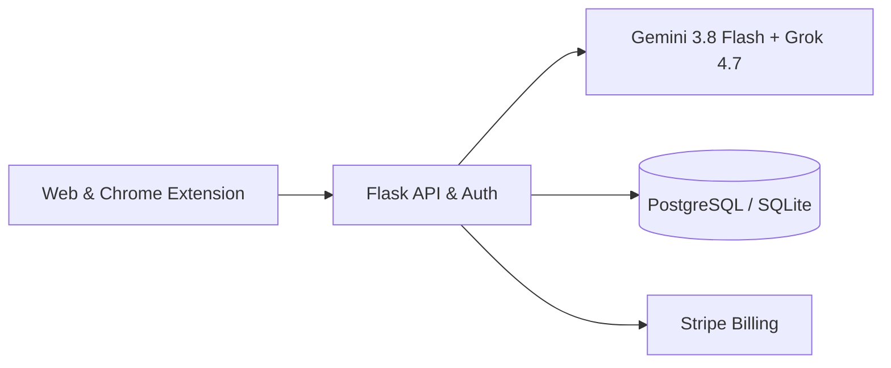

# Authenix

> **Note:** Formerly known as **SatoriCheck**. The internal project folder (`satoricheck/`) keeps the old name so Docker and Cloud Run don't have a meltdown—and because I was too lazy to rename 200 imports by hand.

Authenix is my AI-powered BS detector for live audio streams, text claims, startup pitch decks, and sketchy media. The goal is simple: let it run on the side while someone talks (or while you screen a 40-slide deck at 11 PM), and let it flag Bold Claims™ and fact-check them against reality in real time. It started as a weekend project and snowballed from there. If you have ideas on how to make it better, I am all ears.

**Stack:** Python 3.12+ (Flask), Vanilla JS (zero framework bloat), Google Gemini (`gemini-3.8-flash`), xAI Grok (`grok-4.7`), PostgreSQL / SQLite

---

## What It Actually Does

- **Live Audio & Text Fact-Checking**: Speaks or reads along with you, ignores the small talk, pulls out the actual factual claims, and checks them against live Google Search and social context.
- **Pitch Deck Workstation**: Upload a startup PDF deck and get an instant side-by-side investor memo—VC scorecard metrics, thesis fit, red flags, slide-mapped claim verification, and founder interrogation questions for your next call.
- **Media Forensics**: Drop in an image, video, or audio clip to check if it's real, CGI, or fresh out of an AI generator.
- **Google Gemini + xAI Grok Tag-Team**: Gemini 3.8 Flash handles the heavy lifting (switching between fast `low` thinking for triage and deep `high` thinking for verification), calling in Grok 4.7 whenever a claim involves breaking news, quotes, or viral X/Twitter drama.
- **Chrome Extension (MV3)**: A side-panel companion with 1-click Google login so you can fact-check dubious articles and posts without leaving your tab.
- **Batteries & Check Points (CP)**: Daily login streaks, fair word-based token billing, and Stripe top-ups so my API bill doesn't bankrupt me.
- **Privacy First (Swiss nDSG & GDPR)**: PDFs and media are processed in memory and immediately tossed. History auto-purges after 7 days, and "Delete My Account" actually deletes your account.

---

## Running It Locally

### What You Need
- Python 3.12+ (works great on 3.12 through 3.14)
- Virtual environment (`.venv`) at the repo root

### Quick Start

```bash
# 1. Install dependencies
cd satoricheck
../.venv/bin/pip install -r requirements.txt

# 2. Configure environment
cp .env.example .env    # Add GEMINI_API_KEY and FLASK_SECRET_KEY

# 3. Fire it up
../.venv/bin/python -m backend.server
```

Open **http://127.0.0.1:8000** in your browser.

> Want to click around without burning API credits? Set `TEST_MODE=true` in `.env`.

---

## Testing

Run the test suite from the repository root:

```bash
PYTHONPATH=satoricheck .venv/bin/pytest satoricheck/tests/ --ignore=satoricheck/tests/e2e -v
```

---

## How It's Wired Together



- **Frontend:** Vanilla ES6+ JavaScript, HTML5, and CSS3 custom properties.
- **Backend:** Modular Flask blueprints (`auth`, `billing`, `factcheck`, `media`, `pitchdeck`, `tokens`, `analytics`, `export`).
- **Database:** SQLAlchemy ORM running on SQLite (WAL mode) locally and Cloud SQL (PostgreSQL) on Cloud Run, with automatic column migrations on startup.
- **AI Engine:** Unified `gemini-3.8-flash` client (`backend/services/gemini/`) with context caching, native Google Search grounding, and conditional `grok-4.7` social search.

---

## Legal & License

- [Privacy Policy & Terms of Service](https://authenix.ai/privacy_and_terms)

- All rights reserved. Source-available for portfolio and educational review. If you use this without giving credit, I will karma you so that you stomp your pinky-toe on the bedstand every night henceforth.