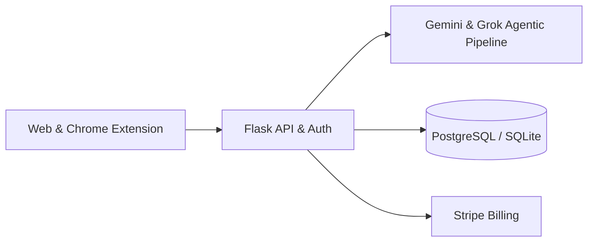

# Authenix

> **Note:** Formerly known as **SatoriCheck**. The internal project directory (`satoricheck/`) retains the legacy name for container and deployment stability. And because I was too lazy to redo everything all over again.

Authenix is my AI-powered verification platform for live audio streams, text claims, pitch decks, and media analysis. I am building towards a live stream verification, where you can let it run on the side while someone speaks, and it will flag suspicious claims and verify them for you. But all in due time, this is a weekend project. If you have inputs on how to improve it, I am all ears.

**Stack:** Python 3.12 (Flask), Vanilla JS, Google Gemini, xAI Grok, PostgreSQL

---

## Features

- **Live Audio & Text Verification**: Real-time speech stream transcription, falsifiable claim extraction, and Flash triage via Gemini Multimodal (`audio_stream_ingestion` & `stream_triage` skills).
- **Pitch Deck & Media Forensics**: Investor workstation with slide-by-slide claim extraction, batch market verification, and AI-generated image/video/audio manipulation forensics.
- **Multi-Source Agentic Grounding**: Thinking-mode verification pipeline grounded in live Google Search metadata and xAI Grok social context, with Gemini Context Caching and concurrent SSRF-safe URL validation.
- **Chrome Extension (MV3)**: Persistent side panel with 1-click Google OAuth, AES-GCM-256 encrypted token storage, and contextual verification.
- **Gamification & Atomic Billing**: Daily login streak rewards, word-accumulated Check Points (CP) with row-level reservation (`SELECT ... FOR UPDATE`), and Stripe webhook fulfillment.
- **Privacy & Swiss nDSG / GDPR Compliance**: In-memory media/PDF processing, 7-day rolling cache auto-purge via Cloud Scheduler, and self-service cascading account deletion.

---

## Local Setup & Prerequisites

### Prerequisites
- Python 3.12+
- Virtual environment (`.venv`) at repository root

### Quick Start

```bash
# 1. Install dependencies
cd satoricheck
../.venv/bin/pip install -r requirements.txt

# 2. Configure environment
cp .env.example .env    # Configure GEMINI_API_KEY, FLASK_SECRET_KEY

# 3. Start development server
../.venv/bin/python -m backend.server
```

Open **http://127.0.0.1:8000** in your browser.

> Set `TEST_MODE=true` in `.env` for local mock testing without live API keys.

---

## Testing

Run the test suite from the repository root:

```bash
PYTHONPATH=satoricheck .venv/bin/pytest satoricheck/tests/ --ignore=satoricheck/tests/e2e -v
```

---

## Architecture Overview



- **Frontend:** Vanilla JavaScript (ES6+), HTML5, and CSS3 custom properties (mobile-first, dark theme).
- **Backend:** Modular Flask blueprints (`auth`, `billing`, `factcheck`, `media`, `pitchdeck`, `tokens`, `analytics`, `export`).
- **Database:** SQLAlchemy ORM with SQLite (WAL mode) locally and Cloud SQL (PostgreSQL) in production, with idempotent startup schema auto-migration.
- **AI Engine:** Modular Gemini service (`backend/services/gemini/`) and domain skills (`backend/agents/skills/`) combining Gemini 3.1 Pro / 3 Flash (multimodal audio/video/PDF, thinking loops, context caching, search grounding) with xAI Grok social search.

---

## Legal & License

- [Privacy Policy](https://gist.github.com/defluff/bccc4d328f850de6eec1521ba4c2be22) & [Terms of Service](https://gist.github.com/defluff/bccc4d328f850de6eec1521ba4c2be22)

- All rights reserved. Source-available for portfolio and educational review. If you use this without giving credit, I will karma you so that you stomp your pinky-toe on the bedstand every night henceforth.